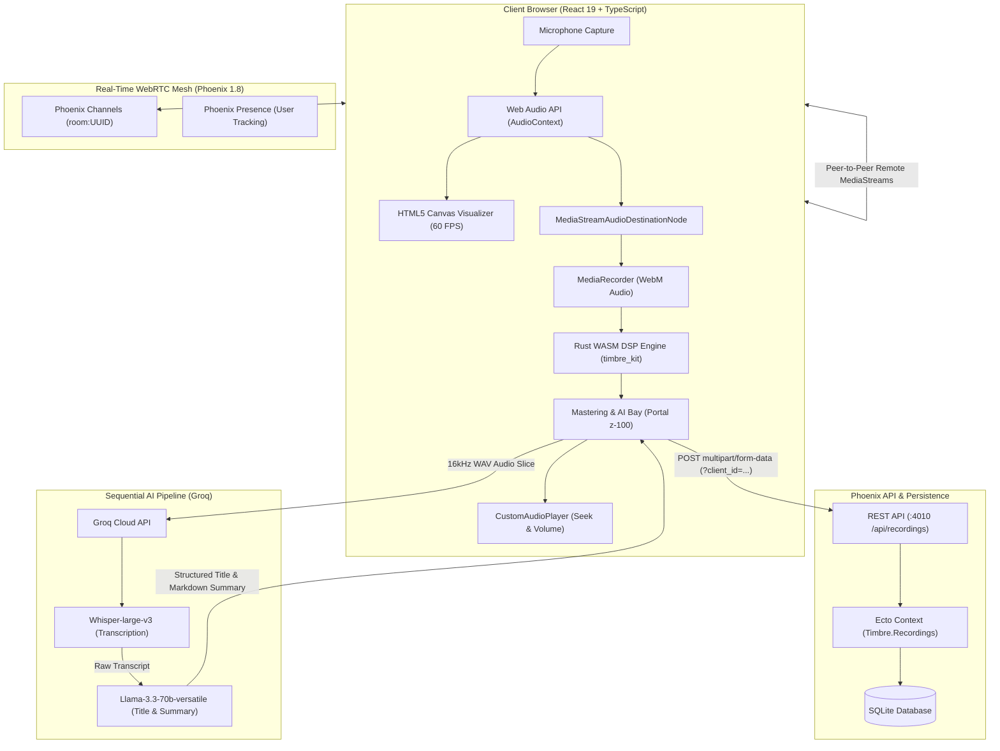

# Timbre: Production-Grade WebRTC Audio Studio

Timbre is a high-performance, browser-based digital audio workstation (DAW) and real-time collaboration studio built with **React 19**, **TypeScript**, and **Tailwind CSS v4**, backed by an in-browser **Rust / WebAssembly (WASM)** DSP engine. The backend is powered by **Elixir** and **Phoenix 1.8**, delivering sub-millisecond WebRTC signaling via Phoenix Channels and persistent audio blob storage backed by **SQLite** and **Ecto**.

---

## Deployment & Demo Links

- **Live Frontend Application:** [Live Frontend URL](https://timbre-gold.vercel.app/)
- **Live Backend API & Socket:** [Live Backend URL](https://timbre-api-t3s5.onrender.com)
- **Walkthrough Demo Video:** [Demo Video URL](https://drive.google.com/file/d/1gRVlB8cMkD1F1f3jCBMcip4ejrAsKhtw/view?usp=sharing)

---

## Architecture Diagram

The diagram below illustrates the end-to-end data flow between the browser audio capture graph, client-side Rust WASM DSP processing, real-time Phoenix signaling channels, SQLite persistence, and Groq cloud inference.



---

## Repository Structure

```text
timbre/
├── api/                            # Phoenix 1.8 REST API & Signaling Server (:4010)
│   ├── config/                     # Environment configs (dev.exs, prod.exs, test.exs)
│   ├── lib/
│   │   ├── timbre/                 # Domain logic & Ecto database layer
│   │   │   ├── recordings/         # Ecto schema for SQLite audio blob storage
│   │   │   ├── recordings.ex       # Context module for query/save operations
│   │   │   ├── release.ex          # Boot-time migration runner (Timbre.Release)
│   │   │   └── repo.ex             # SQLite Ecto repository
│   │   └── timbre_web/             # Phoenix Web layer
│   │       ├── channels/           # RoomChannel for WebRTC Offer/Answer/ICE signaling
│   │       ├── controllers/        # RecordingController (multipart upload & streaming)
│   │       ├── endpoint.ex         # HTTP pipeline, CORS Plug, & WebSocket upgrade
│   │       └── router.ex           # API route declarations (/api/recordings)
│   ├── priv/repo/migrations/       # SQLite database migration scripts
│   ├── rel/                        # Release overlays & scripts for containerized deployments
│   ├── test/                       # ExUnit test suite (controller & channel tests)
│   └── Dockerfile                  # Hardened multi-stage Alpine production image
│
├── web/                            # React 19 + TypeScript + Tailwind CSS v4 Frontend (:5173)
│   ├── crates/
│   │   └── timbre_kit/             # Rust DSP crate compiled to WASM
│   │       ├── src/lib.rs          # Zero-copy audio algorithms (Normalize, Echo, Anonymize)
│   │       ├── Cargo.toml          # wasm-bindgen & js-sys dependencies
│   │       └── pkg/                # Generated WebAssembly binaries & JS bindings
│   ├── src/
│   │   ├── components/
│   │   │   ├── layout/             # StudioLayout (CSS Grid split-pane & navbar header)
│   │   │   ├── mastering/          # MasteringModalOrDrawer (Portal z-100 A/B dialog)
│   │   │   ├── ui/                 # GroqApiKeyInput, buttons, and HUD badges
│   │   │   ├── vault/              # RecordingVault (sidebar & mobile history drawer)
│   │   │   ├── AudioWaveform.tsx   # HTML5 60 FPS Canvas spectrum/oscilloscope
│   │   │   ├── CustomAudioPlayer.tsx # Custom scrubbable audio player with volume
│   │   │   ├── MultiplayerStudio.tsx # WebRTC peer audio grid & mix recorder
│   │   │   └── RecorderUI.tsx      # Solo recording studio & visualizer stage
│   │   ├── hooks/
│   │   │   ├── useAudioRecorder.ts # MediaRecorder & Web Audio API hook
│   │   │   └── useWebRTCMixer.ts   # Phoenix Socket & multi-peer WebRTC mixer hook
│   │   ├── services/
│   │   │   ├── ai.ts               # Groq Cloud API (Whisper-large-v3 & Llama-3.3-70b)
│   │   │   ├── client.ts           # Isolated client UUID & URL room routing
│   │   │   └── dsp.ts              # JS-to-WASM bridge for timbre_kit
│   │   ├── __tests__/              # Vitest test suite (MasteringBay state machine)
│   │   ├── App.tsx                 # Root studio controller & mode switcher
│   │   └── index.css               # Tailwind CSS v4 design tokens & keyframes
│   └── package.json                # Dependencies, scripts (build:wasm, test, build)
│
├── docker-compose.yml              # Local containerized orchestration (API + SQLite)
├── flake.nix                       # Pinned Nix development environment
├── justfile                        # Command automation recipes (setup, dev, test, db)
├── render.yaml                     # Render infrastructure-as-code deployment blueprint
└── README.md                       # Documentation & submission overview
```

---

## Scope Completed

Every core requirement, multi-track collaboration feature, and advanced bonus capability has been fully implemented, rigorously verified, and tested:

- [x] **Part 1: Record & Save (Elixir / Phoenix + SQLite)**
  - [x] In-browser microphone audio capture via standard `MediaRecorder` API.
  - [x] Multi-part binary blob upload pipeline persisting raw audio directly into SQLite via Ecto schemas.
  - [x] Persistent **Recording Vault** sidebar and mobile drawer with client-isolated history (`?client_id=...`).
  - [x] Fully custom, bespoke **CustomAudioPlayer** featuring play/pause, scrubbable progress seeking, time tracking, and volume slider controls.
- [x] **Part 2: Voice Processing (Rust / WASM DSP Engine)**
  - [x] High-performance Rust crate (`timbre_kit`) compiled to `wasm32-unknown-unknown` via `wasm-pack`.
  - [x] **Peak Normalization:** Deterministic amplitude scanning to scale signals to `-1.0 dB` peak without clipping.
  - [x] **Echo / Delay Effect:** Circular buffer feedback loop with configurable delay time (200ms) and decay factor (0.45).
  - [x] **Voice Anonymizer (Bonus Advanced Effect):** Sine-wave ring modulation carrier with randomized non-linear formant shifts for voice scrambling.
  - [x] Side-by-side **A/B Audio Preview Toggle** (Original vs. Processed 16-bit WAV) inside the Mastering Bay.
- [x] **Part 3: Multiplayer WebRTC Mixer (Phoenix Channels)**
  - [x] Dynamic room generation (`crypto.randomUUID()`) with shareable direct URL links (`?room=UUID`).
  - [x] Phoenix Channel signaling server managing peer-to-peer WebRTC Offer/Answer exchanges and ICE candidates.
  - [x] Dynamic multi-track audio routing: routes all remote peer `MediaStream` tracks and local mic into a single browser `MediaStreamAudioDestinationNode`.
  - [x] Unified "Record Mix" button that captures the live, synchronized conference call into a single downloadable and masterable audio file.
- [x] **Bonus: Sequential AI Intelligence Pipeline (Groq Cloud)**
  - [x] State-machine pipeline with clear user feedback and disabled states (`isSaving`, `isTranscribing`, `isSummarizing`).
  - [x] Speech-to-text audio transcription powered by **Whisper-large-v3**.
  - [x] Executive summarization and automatic title extraction powered by **Llama-3.3-70b-versatile**.
  - [x] Vault synchronization saving audio blobs, generated transcripts, and AI summaries into a unified database record.

---

## Local Setup & Development

Follow these steps to run the complete stack locally on your workstation.

### Prerequisites

- **Node.js:** Node `20+` (or `22+`) and `npm`
- **wasm-pack:** `wasm-pack` CLI installed (`cargo install wasm-pack`)
- **Docker:** Docker Desktop / Docker Compose (recommended for the backend)
- *(Optional if running backend without Docker)*: **Elixir:** `1.18+` / OTP `27+`

---

### Step 1: Build the Rust WASM DSP Module

Compile the Rust DSP crate into the WebAssembly package used by the frontend using the npm script:

```bash
cd web
npm run build:wasm
```

> Under the hood, this runs `wasm-pack build crates/timbre_kit --target web --out-dir pkg`, outputting the zero-copy DSP WASM module directly into the frontend package directory.

---

### Step 2: Start the Phoenix API Backend (Docker)

Launch the containerized Phoenix backend and SQLite database with Docker Compose:

```bash
# From the repository root:
docker compose up --build -d
```

> **What this does:**
> - Builds the Alpine-based Phoenix container with synchronized OpenSSL crypto libraries.
> - Runs Ecto database migrations automatically on boot (`mix ecto.migrate`).
> - Exposes the HTTP REST API on `http://localhost:4010` and WebRTC signaling on `ws://localhost:4010/socket`.

*(Alternative without Docker)*:
```bash
cd api
mix deps.get
mix ecto.setup
mix phx.server
```

---

### Step 3: Run the React Frontend

Install dependencies and start the Vite development server:

```bash
cd web
npm install
npm run dev
```

> Open `http://localhost:5173` in your browser. Both the **Rust WASM** and **Phoenix API** indicators in the top navbar will illuminate green once connected.

---

### Alternative: One-Command Setup with `just` (or Nix)

If you have [`just`](https://github.com/casey/just) or [Nix Flakes](https://nixos.org) installed:

```bash
# Setup all dependencies and build WASM in one step:
just setup

# Launch both Phoenix API (:4010) and Vite Web (:5173) concurrently:
just dev
```

---

## Technical Highlights

- **Zero-Copy In-Place WASM DSP:**
  Audio buffers are mapped directly between JavaScript's `Float32Array` and Rust's `&mut [f32]` using `wasm-bindgen` and `js-sys`. Signal calculations run without garbage collection or heap re-allocations during real-time processing, with strict clamping to `[-1.0, 1.0]` to guarantee zero audio clipping or NaN propagation.

- **High-Performance HTML5 Canvas Visualizer:**
  The studio visualizer runs at a locked 60 FPS using browser `requestAnimationFrame` loops attached to a Web Audio `AnalyserNode`. It dynamically alternates between real-time frequency bar spectrums and time-domain oscilloscope waves without triggering React re-renders or layout reflows.

- **Resolved Alpine Docker OpenSSL NIF Crash for Production:**
  Fixed a critical production deployment crash (`load_failed: EVP_PKEY_sign_message_init: symbol not found`) caused by an OpenSSL ABI mismatch between the Elixir Alpine builder and the final runner image. Synchronized the base Alpine versions across stages, installed `openssl libgcc libstdc++ ncurses-libs`, and authored an automated startup migration module (`Timbre.Release.migrate`) to guarantee database schemas migrate on boot before Phoenix starts listening.

- **Bulletproof CSS Stacking & Portaling:**
  The Mastering & AI Bay dialog uses React's `createPortal(modalNode, document.body)` with `fixed inset-0 z-[100]`. This cleanly breaks out of parent CSS stacking contexts (`StudioLayout`'s `relative z-10` container), ensuring the backdrop and modal card render gracefully above the `z-40` navigation bar and `z-50` mobile drawers.

---

## Automated Testing Suite

Run the full end-to-end test suite across all subsystems:

```bash
# Run Rust DSP unit tests:
cd web/crates/timbre_kit && cargo test

# Run Elixir API and Ecto controller tests:
cd api && mix test

# Run React component and AI pipeline state machine tests:
cd web && npm test
```
